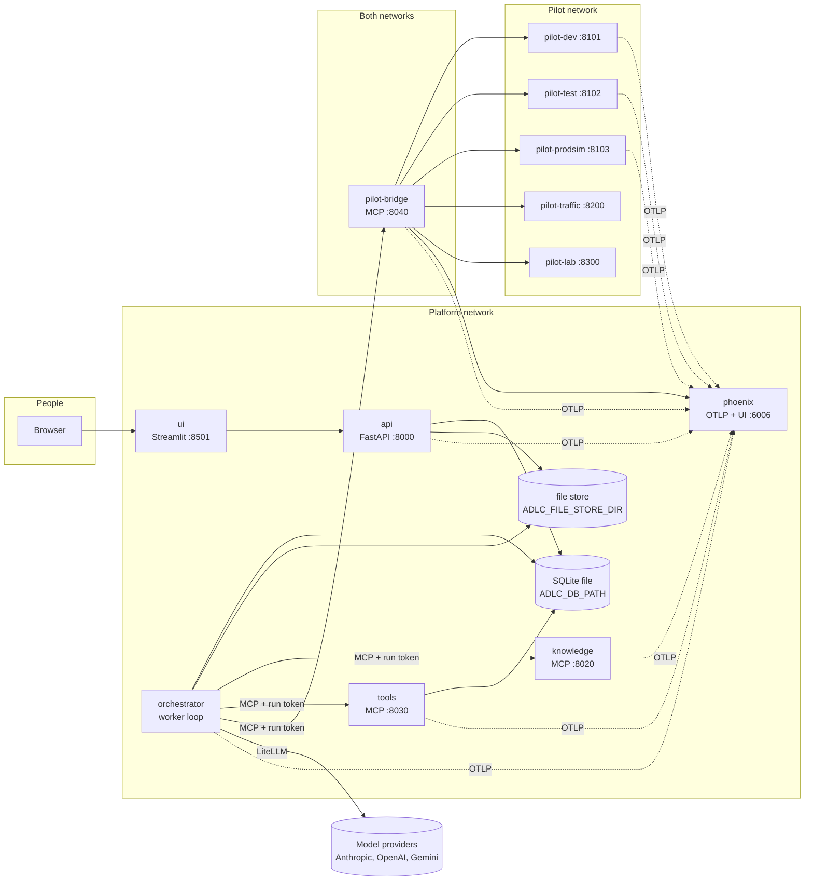
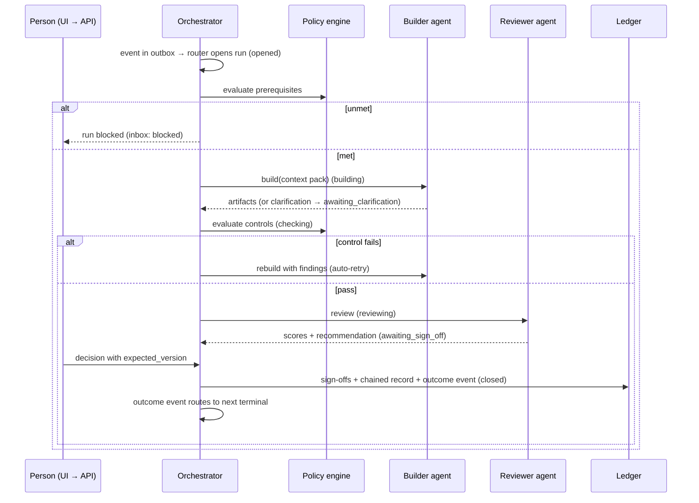

# Agentic ADLC Platform: Technical Design

| | |
| --- | --- |
| **Status** | As built, 2026-11-20 (branch `015-ado-sim-api`: `main` plus the Phase 2 documentation and the 015 work in progress) |
| **Audience** | Engineers who build, run, review or extend the platform |
| **Companion documents** | [Solution architecture](solution-architecture.md) (SA, the intended design), [Terminal design spec](terminal-design-spec.md) (TDS, the lifecycle content), [Build plan](build-plan.md), [Running without Docker](run-without-docker.md), `.specify/memory/constitution.md` |

The SA says what the platform should be and why. This document describes how the code in this
repository actually implements it: the processes, modules, data, interfaces and rules. Where the
build departs from the SA, section 17 lists the difference. Each package's README goes deeper;
each feature's design lives in `specs/NNN-*/`.

---

## Contents

1. [What the platform does](#1-what-the-platform-does)
2. [Design principles](#2-design-principles)
3. [Repository layout](#3-repository-layout)
4. [Runtime architecture](#4-runtime-architecture)
5. [Technology stack](#5-technology-stack)
6. [Spec and configuration layer](#6-spec-and-configuration-layer)
7. [Lifecycle orchestration](#7-lifecycle-orchestration)
8. [Policy engine](#8-policy-engine)
9. [Agent runtime](#9-agent-runtime)
10. [Evidence ledger](#10-evidence-ledger)
11. [Tools and knowledge (MCP)](#11-tools-and-knowledge-mcp)
12. [API, inbox, dashboard and web application](#12-api-inbox-dashboard-and-web-application)
13. [Data architecture](#13-data-architecture)
14. [Security design](#14-security-design)
15. [Observability](#15-observability)
16. [Pilot use case and the ADO simulator](#16-pilot-use-case-and-the-ado-simulator)
17. [Deployment and configuration](#17-deployment-and-configuration)
18. [Build, test and quality](#18-build-test-and-quality)
19. [Demo and operations](#19-demo-and-operations)
20. [Decisions, differences from the SA and known limits](#20-decisions-differences-from-the-sa-and-known-limits)
21. [Glossary](#21-glossary)
- [Annex A: Settings reference](#annex-a-settings-reference)
- [Annex B: Ports and processes](#annex-b-ports-and-processes)

---

## 1. What the platform does

The platform runs the **Agentic Development Lifecycle (ADLC)** for AI use cases. A use case moves
through ten **terminals**, each a lifecycle stage with its own agents, controls and approvers:

| Terminal | Stage | Terminal | Stage |
| --- | --- | --- | --- |
| T0 | Intake & Qualification | T5 | Trust, Risk & Assurance |
| T1 | Requirements & Outcome | T6 | Release Readiness |
| T2 | Architecture & Design | T7 | Deployment & Transition |
| T3 | Build & Integration | T8 | Operate & Observe |
| T4 | Evaluation | T9 | Evolve / Retire |

In each terminal run:

1. **An agent builds** the terminal's artifacts from a context pack (intake, earlier evidence,
   grounding documents, tools).
2. **Deterministic controls** check the artifacts (policy engine, no model involved).
3. **An independent reviewer agent** scores them against the terminal's checklist and recommends
   an outcome.
4. **People decide**: the roles the spec names sign off with an outcome (pass, rework, exception,
   escalate, terminate, ...).
5. **The outcome is recorded** in a hash-chained ledger record, and its event routes the use case
   to the next terminal (or back, for rework).

What a terminal does (prerequisites, controls, routing, approvers, timelines) comes entirely from
versioned YAML specs in `adlc-specs/`. The code holds the mechanism and no terminal-specific values.

The pilot use case, an **Incident Triage Assistant** (`pilot/`), is built, evaluated, deployed and
operated by the lifecycle in the demo.

---

## 2. Design principles

The constitution (`.specify/memory/constitution.md`, version 1.2.0 proposed) governs every
feature. The articles and how the code enforces them:

| Article | Rule | Enforced by |
| --- | --- | --- |
| I Spec-driven lifecycle | Lifecycle behaviour comes from specs only | `tests/unit/test_no_hardcoded_values.py` scans the code for terminal ids, events, roles and routes |
| II Superset, not values | Specs declare the superset; values come from catalogues and profiles | Catalogues in `adlc-specs/shared/`; parameter resolution within guardrails |
| III Agents build, humans decide | Only human decisions close a run with an outcome | State machine property tests (`orchestration/states.py`) |
| IV Separation of duties | Agents act through scoped permissions | `policy.authorize` before every tool call; run tokens |
| V Evidence-first | Append-only history, hash-chained ledger | Database triggers; `adlc-ledger verify` |
| VI Deterministic before judgement | Computable rules never go to a model | Policy engine (CEL and predicates) |
| VII Interfaces at every boundary | Components meet through protocols, APIs and MCP | Boundary tests (UI, knowledge, tools, pilot, ADO simulator) |
| VIII Open source, Python first | Python 3.12, OSI licences, recorded dependencies | Reviews; licence tables in each feature's research |
| IX Test first for the core | Core logic is written test first | `make check`, coverage gates |
| X Observable by default | Logs, traces, run activity | `adlc.observability`; `run_activity` rows |
| XI Secure by default | Least privilege, secrets from the environment, fail closed | Settings, sessions, policy, tokens, secret scan |
| XII Simplicity for the MVP | One host, one data store, no extra brokers | SQLite, outbox polling, one compose file |
| XIII Naming | SA Annex A conventions | Reviews; validation rules |

---

## 3. Repository layout

| Path | Contents |
| --- | --- |
| `src/adlc/` | The platform: 17 packages, about 27,800 lines of Python (section 4.2) |
| `adlc-specs/` | Runtime specs: `terminals/T0..T9.yaml`, `checklists/`, `playbooks/`, `prompts/`, `shared/` catalogues, `schema/` (JSON Schemas). Never in `specs/` |
| `db/migrations/` | Alembic environment and the baseline revision `0001_baseline.py` |
| `tests/` | `unit/` (103 files), `integration/` (115 files), `scenario/`, `support/`, `fixtures/` (about 22,500 lines) |
| `pilot/` | The pilot use case: its own uv project (feature 009) |
| `ado_sim/` | The ADO simulator: its own uv project (feature 015, in progress) |
| `deploy/` | `compose.yaml`, Dockerfiles, `Procfile.local`, `local.env`, `phoenix/` (Phoenix as its own uv project), helper scripts |
| `scripts/` | Demo driver, resilience drill, synthetic data, migration check |
| `data/` | Synthetic evidence (`data/synthetic/`), knowledge documents; `data/local/` is the git-ignored store when running without Docker |
| `docs/` | SA, TDS, build plan, this document, run-without-docker, draw.io diagrams |
| `specs/NNN-*/` | Spec Kit feature folders (spec, plan, research, data model, contracts, tasks), features 001–015 |
| `.specify/` | Spec Kit configuration, templates, the constitution |
| `Makefile` | The single entry point for developers and CI |

---

## 4. Runtime architecture

### 4.1 Processes



| Process | Command | Role |
| --- | --- | --- |
| `api` | `adlc-api` | The only way people (and the UI) reach the platform: sign-in, inbox, decisions, edits, dashboards. Never advances runs |
| `orchestrator` | `adlc-orchestrator run` | Polls the outbox, timers and monitors; advances runs (prerequisites, build, controls, review) |
| `ui` | `streamlit run src/adlc/ui/app.py` | Web application; talks only to the API |
| `knowledge` | `adlc-knowledge` | Read-only grounding documents as MCP servers |
| `tools` | `adlc-tools` | Enterprise MCP mocks (ITSM, CMDB, IAM, GRC, eval store, ...) |
| `pilot-bridge` | `adlc-pilot-bridge` | MCP servers that act on the pilot (environments, git, CI, deploy, traffic, kill switch, monitoring) |
| `phoenix` | `phoenix serve` | Trace collector and viewer |
| `migrate`, `register` | `alembic upgrade head`, `adlc-spec register adlc-specs` | One-shot set-up (compose); `make local-setup` without Docker |
| pilot processes | `pilot-host`, `pilot-traffic`, `pilot-lab` | The pilot's environments, traffic and lab (section 16) |

### 4.2 Packages (`src/adlc/`)

| Package | Feature | Lines | Responsibility |
| --- | --- | --- | --- |
| `config` | 001 | 580 | Typed settings from the environment |
| `db` | 001 | 280 | SQLite engine, transactions, value adapters |
| `identity` | 001 | 430 | Local accounts, password hashing, sessions, roles |
| `observability` | 001 | 140 | Logging with redaction, OpenTelemetry tracing |
| `spec_toolkit` | 002 | 3,840 | Spec validation (L1–L5), registration, `SpecRegistry` |
| `orchestration` | 003 | 4,540 | Run state machine, engine, router, outbox, timers, monitors |
| `policy` | 004 | 3,170 | CEL evaluation, predicates, evidence, authorization, parameters |
| `ledger` | 005 | 1,540 | Content store, artifact versions, ledger records, verification, profiles |
| `agents` | 006, 008 | 4,530 | Model gateway, builder and reviewer loops, context, tools, cost |
| `api` | 001, 007 | 940 | FastAPI app, sessions, routes, errors |
| `inbox` | 007, 012 | 940 | Inbox items, run detail, decision forms, role rules, change requests |
| `knowledge` | 008 | 460 | Knowledge MCP server (documents, BM25 search, scope, data class) |
| `tools` | 010 | 2,940 | MCP tool servers, run tokens, tool catalogue, pilot bridge, probe |
| `dashboard` | 013 | 930 | Read-only journey, activity, KPIs, portfolio |
| `ui` | 007, 013 | 1,900 | Streamlit pages, API client, rendering rules |
| `demo` | 014 | 620 | `adlc-demo`: scripted end-to-end demo |
| `cli` | 001 | 40 | `adlc-account` (account file helper) |

Dependencies point one way: `ui` depends only on `config` and the API; `knowledge` and `tools`
servers import nothing from orchestration, ledger, policy, agents, API or inbox; the
orchestration engine depends on the `PolicyEngine`, `AgentRunner`, `Reviewer` and `Clock`
protocols, wired to the real implementations in `orchestration/__main__.py`.

---

## 5. Technology stack

| Concern | As built | Notes |
| --- | --- | --- |
| Language | Python 3.12, uv, ruff, mypy strict, pytest | Separate uv projects: platform, `pilot/`, `ado_sim/`, `deploy/phoenix/` |
| Spec format | YAML + JSON Schema + CEL | `ruamel.yaml`, `jsonschema`, `cel-python` |
| Data store | SQLite (one file, WAL) through SQLAlchemy 2 Core | Alembic migrations; changed from PostgreSQL (section 20) |
| Workflow | Own state machine in the database, one transaction per signal | ADR-01 |
| Events | Transactional outbox polled by the orchestrator | No broker |
| Models | LiteLLM gateway; Anthropic primary, then OpenAI, then Gemini | ADR-02; `ADLC_MODEL_PROFILE` |
| Policy | CEL evaluator plus 60 catalogued predicates | `cel-python` |
| Tools | MCP (`mcp` SDK 1.30.0), streamable HTTP, stateless | Run tokens (HMAC-SHA256) |
| API | FastAPI 0.162, uvicorn, pydantic 2, itsdangerous sessions | |
| Web app | Streamlit 1.66, Plotly | Calls only the API |
| Files | Content-addressed file store on disk | `ADLC_FILE_STORE_DIR` |
| Tracing | OpenTelemetry → Arize Phoenix 21 (OTLP/HTTP, port 6006) | Replaced Jaeger; all hosted infrastructure is Python |
| Packaging | Docker Compose on one host, or `make local` (honcho) without Docker | |
| CI | GitHub Actions running `make check` | |

---

## 6. Spec and configuration layer

### 6.1 Spec folder (`adlc-specs/`)

| Path | Contents |
| --- | --- |
| `terminals/T0..T9.yaml` | One spec per terminal: `metadata`, `trigger`, `prerequisites`, `actors`, `authorities`, `playbooks`, `controls`, `evidence`, `outcome_model`, `timeline`, and for continuous terminals `monitors` |
| `checklists/t0..t9.yaml` | The reviewer's scored checklist items per terminal |
| `playbooks/*.md`, `prompts/*` | Agent instructions with front matter (validated against `schema/*-front-matter.schema.json`), hashed at registration |
| `shared/*.yaml` | Catalogues: `roles`, `agents`, `model_catalogue`, `model_tiers`, `permissions`, `predicates`, `risk_tiers`, `data_classes`, `change_classes`, `events`, `route_destinations`, `root_causes`, `evidence_sources`, `guardrails`, `metrics`, `mcp_servers` |
| `schema/` | JSON Schemas (`terminal.schema.json`, checklist, front matter) |

### 6.2 Validation and registration (`spec_toolkit`)

`adlc-spec validate` runs five levels and reports each finding with file, line and rule id:

| Level | Checks |
| --- | --- |
| L1 | Parse and layout |
| L2 | JSON Schema |
| L3 | Single-spec rules |
| L4 | Cross-spec and catalogue rules, including the event and route graph (networkx) |
| L5 | Version bumps against git `main`, and against the registry at registration |

`adlc-spec register` validates and then writes new versions into the registry tables
(`spec_registry`, `spec_catalogue`, `spec_trigger`, `spec_outcome_route`, `spec_event_route`,
`spec_change_class`, `spec_timeline`, `playbook_registry`, `prompt_registry`) in one locked
transaction. Rule ids are documented in `specs/002-terminal-spec-toolkit/contracts/validation-rules.md`,
and a test keeps code and table in step.

### 6.3 Reading specs at run time

Code never reads YAML at run time. It reads the registry through `SpecRegistry`
(`SqlSpecRegistry`, or `InMemorySpecRegistry` in tests); both share `projections.py`, so they
agree. A use case **pins** spec versions when it is submitted (`usecase_spec_pin`); its runs use
those versions even if newer ones are registered.

### 6.4 Parameters

Values a spec leaves open (thresholds, limits) are resolved by `policy/parameters.py` within the
guardrails catalogue when a run opens, and frozen in `run_parameter_set`.

---

## 7. Lifecycle orchestration

### 7.1 Run state machine

```text
opened ─► building ─► checking ─► reviewing ─► awaiting_sign_off ─► closed
  │           │  ▲         │                         │  ▲
  ▼           ▼  └─retry───┘                         │  └─ waiver rejected
blocked   awaiting_clarification                      ▼
                                        escalated ─► awaiting_sign_off (completed by A role)
```

- `states.py` is a pure transition table: states, signals, the actors allowed to send each
  signal, and the effects. Hypothesis property tests prove that only human decisions close a run
  with an outcome and that only the orchestrator's rules escalate.
- `engine.py` (`SqlTerminalRun`) applies **one signal per transaction**: lock the run row, run
  `transition()`, execute the effects, write `run_transition` and `run_activity`. A closing signal
  writes the sign-offs, the chained ledger record and the outcome event in the same transaction.
- **Automatic steps** (prerequisites, build, controls, review) go through `advance()`: lease the
  run, call the policy engine, agent or reviewer **outside** any transaction, then apply the
  result with a version check. A result for a run that has moved on is recorded as `stale`. An
  expired lease counts as an automatic retry.
- Every run carries a **version**. Human operations send the version they saw; a different one
  is refused as stale (409).

### 7.2 Events, routing and delivery

| Module | Behaviour |
| --- | --- |
| `router.py` | An event opens runs in the terminals whose trigger matches it, or signals waiting runs; outcome routes and event routes come from the pinned specs |
| `outbox.py` | Ordered delivery per use case, idempotent (`processed_event`), retries at 10 s, 1 min, 5 min, 15 min, dead letter after 5 attempts (`dead_letter_action`, re-queued by the CoE role) |
| `timers.py` | `escalate_after`, `clarification_sla`, `review_due` (continuous terminals) |
| `monitors.py` | For terminals that declare `monitors`: each threshold is evaluated by the policy engine every `ADLC_MONITOR_INTERVAL`; a breach raises `<terminal>.event.<name>` once per episode |
| `worker.py` | The loop: poll every `ADLC_POLL_INTERVAL`, lease work, write a heartbeat (`orchestrator_heartbeat`) |

Event names follow SA Annex A: `<terminal>.<outcome>[.<root cause>]`, for example
`T4.rework.implementation` or `T8.event.<name>`.

### 7.3 One terminal run, end to end



---

## 8. Policy engine

`adlc.policy` implements the orchestrator's `PolicyEngine` protocol.

| Call | Used for |
| --- | --- |
| `evaluate(expression, context)` | Prerequisites, controls, approver and external-body conditions, event follow-on conditions, monitor thresholds |
| `authorize(actor, action, resource, context)` | Agent and tool actions: run scope, then deny, then allow, then default deny |

- **Evaluation.** The CEL expression is compiled once and cached. Each referenced path is
  resolved in the **evidence** (`activation.py`), and the 60 catalogued predicates explain any
  failure (table, row, column or missing path).
- **Fail closed.** Anything but `true` is *not passed*, with a reason. Errors, missing evidence,
  non-boolean results, more than 1 s, 10,000 rows or 100,000 characters all fail closed.
  Approval conditions that cannot be evaluated require the approval; follow-on conditions that
  cannot be evaluated do not fire.
- **Evidence sources.** The latest closed run of each terminal, the run, intake, trigger,
  timeline, tier, waivers, parameters, the directory (account file), and the pilot's real
  evidence (`pilot_evidence.py`). Sources not yet provided by a real system come from
  `data/synthetic/`, and every decision that reads them is labelled `synthetic`.
- **Audit.** Each call writes one append-only row in `policy_decision` (inputs and reason) and
  runs in the span `adlc.policy.<evaluate|authorize>`.

---

## 9. Agent runtime

`adlc.agents` implements the `AgentRunner` and `Reviewer` protocols.

- **Model selection.** A terminal spec asks for a **tier** (`reasoning`, `coding`, `standard`),
  never a model. `shared/model_catalogue.yaml` maps each tier to an ordered list per profile
  (`default`: Anthropic Claude Opus 5.5 and Sonnet 5.5, then OpenAI, then Gemini; `dev`: small
  models first). `ADLC_MODEL_PROFILE` picks the profile.
- **Gateway rules** (`gateway.py`). Walk the tier's models in order and skip an entry without a
  key, whose approved data class ranks below the run's ceiling (an unresolved ceiling counts as
  the highest, failing closed), or whose context window is too small. Fall back to the next entry
  **only on outages** (rate limit, unavailable). `LiteLLMTransport` is the only code that calls a
  provider; keys are passed per call and never logged or stored.
- **Bounded loop** (`runner.py`). Step, token and time limits per tier (`ADLC_AGENT_LIMITS`, with
  terminal overrides); output validated against the artifact schema, with up to
  `ADLC_AGENT_CORRECTIONS` correction messages.
- **Context pack** (`context.py`). Intake, prerequisite evidence, earlier artifacts and the
  playbooks and prompts, whose hashes must match the registry. Untrusted text is wrapped in
  `<data>` blocks. The pack is hashed for the record.
- **Independent reviewer** (`reviewer.py`). Gets the artifacts and checklist, never the builder's
  reasoning, and returns scores, findings and a recommendation.
- **Tools** (`tools.py`, `mcp_tools.py`, `knowledge.py`). Every tool call passes `ToolGate`, which
  calls `policy.authorize` first; MCP calls carry a run token.
- **Records.** `model_call` (tokens, cost, outcome), `agent_attempt`, `knowledge_retrieval`,
  `artifact_citation`, `cost_alert` (`ADLC_COST_ALERT_LEVELS`). `startup.py` refuses to start
  when a needed tier has no keyed model.
- **Replay.** `adlc-replay` runs reference use cases through the grounded terminals, from
  recordings or live, with a quality report.

---

## 10. Evidence ledger

`adlc.ledger` stores what each run produced, who produced each version, the use-case profile, and
the proof that none of it changed.

- **Content store.** Structured content goes in `content_blob`, keyed by the sha256 of its
  normalised JSON. Files go to the file store at `<root>/<aa>/<bb>/<hex>`, written to a temporary
  file and renamed, after checks on size (`ADLC_ATTACHMENT_MAX`), type (`ADLC_ATTACHMENT_TYPES`)
  and content. Office files with macros are refused.
- **Artifact versions.** A new `artifact_version` is written only when content changes or
  attachments are added, with its producer (agent attempt or person). People edit artifacts
  through the API: an edit commits a new version, voids earlier pass approvals, withdraws a
  pending waiver and bumps the run version.
- **Ledger records.** Closing a run writes a version-2 record: each artifact's id, version,
  content hash, producer and attachments; emitted references; the profile version; `bound_to`
  (the package hash the record is bound to). Each record holds the hash of the previous one in
  the use case: a hash chain.
- **Profile.** The use case's values are versioned (`profile_version`); a run reads the version
  current when it opened. A passing close that emits values writes the next version.
- **Verification.** `adlc-ledger verify [--usecase UC-nnnn] [--json]` recomputes the chain and
  content hashes and records each check in `verification_run`. It detects any changed or removed
  record, including one made by bypassing the database triggers.

---

## 11. Tools and knowledge (MCP)

| Server process | Servers | Notes |
| --- | --- | --- |
| `knowledge` | One MCP endpoint per source folder at `/mcp/<source>/`, tools `search` (BM25) and `read` | Read-only. Scope (path prefixes or collection labels from the pinned spec) and data class enforced server-side; bearer `ADLC_KNOWLEDGE_TOKEN`; host allow-list |
| `tools` | `eval_store`, `servicenow`, `cmdb`, `agent_registry`, `iam`, `grc`, `control_library` | Enterprise mocks; records in `enterprise_record` |
| `pilot-bridge` | `pilot_env`, `git`, `ci`, `artifact_store`, `prompt_registry`, `dataset_registry`, `harness`, `redteam_harness`, `dlp_scanner`, `cd`, `traffic_manager`, `kill_switch`, `observability`, `monitoring`, `feedback` | On both networks; holds no database, model or session settings |

Which process serves a server is the `host` field of `shared/mcp_servers.yaml`. Rules:

- **Checked twice.** The tool gate authorises the call against the terminal's tool scopes
  (policy engine), then the server verifies the **run token**: HMAC-SHA256 over canonical JSON,
  valid five minutes, carrying the scopes and **bound values**.
- **Bound values.** Branch (`uc/<run id>`), environment, candidate hash and authorised hash come
  from the run and the real ledger evidence, never from the model. Synthetic or ambiguous
  evidence binds nothing and the call is refused.
- **Records.** Every call, including refusals, in `tool_call`; evidence results in
  `tool_result`. Both append-only.
- **Probe.** `adlc-tools-probe` calls a tool as a terminal through the real gate, token and
  records (development and demo).

---

## 12. API, inbox, dashboard and web application

### 12.1 API (`adlc.api`)

Every path needs a session except `PUBLIC_PATHS` (`/health`, `/auth/sign-in`).

| Area | Routes |
| --- | --- |
| Auth | `POST /auth/sign-in`, `POST /auth/sign-out`, `GET /auth/me` |
| Use cases | submit, list, `GET /usecases/{id}`, `POST /usecases/{id}/verify` |
| Inbox | `GET /inbox` |
| Runs | `POST /runs/{run_id}/decisions`, `POST /runs/{run_id}/escalation`, artifacts (`PUT`, spreadsheet, attachments, history), `GET /runs/{run_id}/attachments/{hash}` |
| Requests | `POST /clarifications/{id}/answers`, `POST /waivers/{id}/decision`, dead letters (list, detail, re-queue) |
| Changes and events | `GET /changes`, `POST /changes/{id}/decision`, `GET /events/proposed`, `POST /events/proposed/...` |
| Dashboard | `GET /dashboard/usecases/{id}/journey`, `/kpis`, `/portfolio`, `/activity`, `/runs/{run_id}/timeline` |

Rules for every operation:

- **Who acts** is always the signed-in person; a body naming an actor, account or role is refused
  (`extra="forbid"`). Role checks live in the services (`inbox/rules.py`), shared with the inbox,
  so an item never offers an action the operation would refuse.
- **Versions.** Decisions, edits, uploads and escalation completion carry `expected_version`; a
  mismatch answers `409 stale`.
- **One error body** `{"kind", "detail", "field"?}`: 401 `not_signed_in`, 403 `not_allowed`, 404
  `not_found`, 409 `stale` or `wrong_state`, 422 `invalid`. No stack traces.
- **Downloads** carry `Content-Disposition: attachment`, `nosniff`, a sandboxing CSP and
  `no-store`.

### 12.2 Inbox (`adlc.inbox`)

Nothing is stored: items are derived from orchestration, ledger and agent tables. Item kinds:
`sign_off`, `clarification`, `escalation`, `waiver`, `blocked`, `dead_letter` (CoE only), ordered
soonest due first. `forms.py` builds the decision form from the pinned spec (allowed outcomes,
required fields, root causes, the reviewer's recommendation). Feature 012 adds change requests
(approved by the role owning the ITSM server) and proposed operational events.

### 12.3 Dashboard (`adlc.dashboard`)

Read-only views: the **journey** (one lane per terminal, a bar per run, arrows for rework,
reroute, exception, event and re-entry), the **activity** feed, the **time split** per state, and
the SA §12.3 **KPIs** (lifecycle elapsed, time per terminal, reworks by root cause,
clarifications, first-pass yield, escalations, reviewer–human agreement, human edit rate, control
first-time pass rate, SLA adherence). A KPI with nothing measured is `null`, never zero.

### 12.4 Web application (`adlc.ui`)

Streamlit, calling only the API through `client.ApiClient`; the bearer token stays in server-side
session state. Pages: Sign-in, Inbox, New use case, Use cases, Run, Clarification, Escalation,
Waiver, Dead letters, Journey, Activity, Portfolio. Text written by agents or people is shown
only as plain text or data (never Markdown, HTML or widget labels); attachments are download
only. A boundary test allows imports of only `adlc.ui` and `adlc.config`.

---

## 13. Data architecture

### 13.1 Store

One SQLite file (`ADLC_DB_PATH`) shared by every platform process on the host, opened through
`adlc.db`:

- write-ahead log, foreign keys on, busy timeout `ADLC_DB_BUSY_TIMEOUT`;
- `engine.begin()` starts `BEGIN IMMEDIATE` and holds the single write lock, so two workers can
  never claim the same event, timer or run; `engine.connect()` reads without waiting for writers;
- `write_independently(engine, fn)` defers a write until the outer transaction ends (no second
  writing connection inside a transaction);
- times are ISO 8601 text in UTC with microseconds (text order is time order); typed columns
  (`timestamptz`, `jsonb`, `uuid`, ...) are converted by registered adapters; `now()` and `regexp`
  SQL functions are provided.

Services never create the file; only migrations do (`open_engine(create=True)`).

### 13.2 Areas and tables

The four owned areas of SA §10 are table-name prefixes in one file (formerly PostgreSQL schemas):

| Area | Tables |
| --- | --- |
| `spec` | `spec_registry`, `spec_catalogue`, `spec_trigger`, `spec_outcome_route`, `spec_event_route`, `spec_change_class`, `spec_timeline`, `playbook_registry`, `prompt_registry` |
| `run` | `usecase`, `usecase_spec_pin`, `terminal_run`, `run_transition`, `run_activity`, `sign_off`, `clarification_round`, `clarification_answer`, `waiver`, `timer`, `run_parameter_set`, `policy_decision`, `agent_attempt`, `model_call`, `cost_alert`, `knowledge_retrieval`, `artifact_citation`, `orchestrator_heartbeat`, `sequence_counter` |
| `ledger` | `ledger_record`, `content_blob`, `file_object`, `artifact_version`, `artifact_attachment`, `checklist_result`, `profile_version`, `verification_run` |
| `events` | `outbox_event`, `processed_event`, `dead_letter_action` |
| tools | `tool_call`, `tool_result`, `enterprise_record` |

Views (`v_run_step`, `v_usecase_terminal_summary`, `v_run_cost`, `v_terminal_cost`,
`v_usecase_cost`, ...) serve the inbox and dashboard. Identifiers: use cases `UC-0001`, waivers
`WVR-0001` (sequence counters), runs and events UUID v7.

### 13.3 Append-only history

Triggers refuse UPDATE and DELETE, for every connection, on 31 tables: the ledger, the spec
history, run transitions and activity, sign-offs, clarifications, dead-letter actions, policy
decisions, parameter sets, content, files, profiles, verifications, artifact versions,
attachments, checklist results, prompts, agent attempts, model calls, cost alerts, retrievals,
citations, and tool calls, results and records. The hash chain detects any bypass (section 10).

### 13.4 Migrations

Alembic, one baseline revision (`db/migrations/versions/0001_baseline.py`). `make migrate`,
`make migrate-down`, and `make migration-check` (upgrade, downgrade, upgrade again on a scratch
file). Applying twice changes nothing.

---

## 14. Security design

| Concern | Design |
| --- | --- |
| Authentication | Local accounts in `ADLC_ACCOUNTS_FILE` (outside the repo), stdlib scrypt hashes (`scrypt$n$r$p$salt$hash`); a placeholder never signs in and stops start-up in `demo`. Behind the `IdentityProvider` protocol, so OIDC can replace it |
| Sessions | itsdangerous signed tokens (`ADLC_SESSION_SECRET`), expire after `ADLC_SESSION_TTL`; sign-out revocations kept in memory |
| Authorisation (people) | Roles from `adlc-specs/shared/roles.yaml`; who may act is computed from the pinned spec (`inbox/rules.py`); the API enforces, the UI only hides |
| Authorisation (agents) | `policy.authorize` before every agent action and tool call (default deny); run tokens bound to scopes and values, verified again by each MCP server |
| Data classes | Model choice and knowledge results limited by the run's data-class ceiling; unknown ceilings fail closed |
| Secrets | Environment only (`.env`, git-ignored; `.env.example` holds `REPLACE_ME` placeholders, kept in step with the settings by a test); `SecretStr`; never logged, traced or stored; `make secret-scan` (gitleaks) in `make check` |
| Logging | A filter drops credential-like attributes; request bodies are never logged or traced |
| Untrusted content | Agent and person text rendered as plain text; uploads checked by size, type and content, macros refused; downloads sandboxed; prompts wrap untrusted text in `<data>` blocks |
| Evidence integrity | Append-only triggers plus the hash chain and `adlc-ledger verify` |
| Network | Compose: the pilot on its own network, reached only through the bridge; MCP servers check host headers |

Accepted limits: SQLite has no database identities (any process with write access to the file
could drop a trigger; verification detects the change); session revocations are lost on API
restart; no sign-in lockout in the MVP.

---

## 15. Observability

- **Logs.** Plain stdlib logging to stderr (`ADLC_LOG_LEVEL`), with credential redaction; sign-in
  attempts are logged by outcome only.
- **Traces.** OpenTelemetry, batch-exported over OTLP/HTTP to `ADLC_OTLP_ENDPOINT` (Phoenix).
  Projects are set with `OTEL_RESOURCE_ATTRIBUTES=openinference.project.name=...`
  (`adlc-platform`, `pilot-triage-dev`, `pilot-triage-test`, `pilot-triage-prod-sim`). `/health`
  is not traced; headers are never captured; span attributes follow allow lists; exporter
  failures become rate-limited warnings and never affect requests.
- **Run activity.** Every step writes `run_activity` (who, what, outcome), the source of the
  journey, activity feed and KPIs.
- **Pilot telemetry.** The bridge reads the pilot's spans from Phoenix's REST API
  (`/v1/projects/{project}/spans`) for the observability and monitoring tools.
- **Health.** Each service has `/health`; the orchestrator writes heartbeats
  (`ADLC_HEARTBEAT_MAX_AGE`).

---

## 16. Pilot use case and the ADO simulator

### 16.1 Pilot: Incident Triage Assistant (`pilot/`, feature 009)

A separate uv project that never imports the platform. For an incident it returns a category,
priority, resolver team and reason, using two mocked tools (service catalogue, team directory).

- **Golden template** (`pilot/template/`): agent code, reference data, infrastructure definitions
  for `dev`, `test`, `prod-sim`. T3 writes the **fill** (instructions, routing rules, tool bindings,
  thresholds, settings).
- **Packages.** `pilot-build` validates a fill and writes a deterministic archive; its sha256 is
  the package hash. The registry is `PILOT_REGISTRY` (`/packages` in compose,
  `data/local/pilot/packages` without Docker).
- **Environments.** `pilot-host --env dev|test|prod-sim` runs packages as worker processes;
  prod-sim adds deployments (stable, candidate), traffic split (shadow, canary, full) and faults
  (`model_swap`, `pii_leak`). Every operation is appended to JSON Lines records.
- **Traffic and data.** `pilot-traffic` sends a steady stream to prod-sim and reports accuracy and
  leak rate; `pilot-incidents` makes reproducible synthetic incidents.
- **Models.** A deterministic simulated model by default; an OpenAI-compatible model can be
  switched on in dev and test (`PILOT_MODEL_*`).

### 16.2 ADO simulator (`ado_sim/`, feature 015, in progress)

Phase 2, Option A (SA §22) makes an Azure DevOps board the people's interface while the backend
stays as built. As there is no real ADO organisation, the simulator is the contract reference.

- **What it is.** A separate uv project (no imports to or from `adlc`): FastAPI, its own SQLite
  file through stdlib `sqlite3`, an ADO REST API 7.1 subset: work items (create, get, list, batch,
  JSON Patch update with `test /rev` → 412), updates and revisions, a WIQL subset (flat and
  one-hop link queries; everything else refused by name), links (parent/child,
  predecessor/successor), comments (`7.1-preview.4`), work item types, states, fields, areas, and
  identities.
- **Board model.** A seed file (`ado_sim/seed/demo.yaml`) defines the Agile process with the
  Epic's states as the ten terminal stages, the `Custom.Adlc*` fields and one identity per role
  plus the platform's service account. Data only.
- **Access.** Personal access tokens issued by `ado-sim token issue`, stored only as HMAC-SHA256
  (`ADO_SIM_TOKEN_KEY`); every failure is the same empty 401.
- **Fidelity.** Behaviour follows the Microsoft Learn 7.1 reference: a link added from item B
  records an update on item A without a new revision; a comment creates a revision; date
  comparisons in WIQL need `timePrecision=true` to include times.
- **Contract.** `ado_sim/contract/openapi.json` (generated, checked by
  `ado-sim export-openapi --check`); request and response fixtures and the list of known
  differences are still to come.
- **Status.** Tasks T001–T039 done (182 tests, 96% coverage); fixtures, property tests,
  deployment (compose service, `Procfile.local`, `ado-sim-check` in `make check`) and
  documentation remain. Features 016–020 (engagement layer, board, backlog and form, operations
  console, end-to-end demo on the board) follow.

---

## 17. Deployment and configuration

### 17.1 Docker Compose (`deploy/compose.yaml`)

Services: `phoenix`, `migrate`, `register` (one-shot), `api`, `ui`, `knowledge`, `orchestrator`,
`tools`, `pilot-bridge`, `pilot-dev`, `pilot-test`, `pilot-prodsim`, `pilot-traffic`, `pilot-lab`,
and `pilot-tools` (profile `tools`, for the pilot's command-line tools).

| Networks | Volumes |
| --- | --- |
| `adlc-platform` (platform services), `adlc-pilot` (pilot); only `pilot-bridge` joins both | `adlc-db` (SQLite file), `adlc-files` (file store), `phoenix-data`, `pilot-packages`, `pilot-records`, `pilot-data`, `bridge-data` |

`make up`, `make down`, `make status`, `make reset` (confirmation required).

### 17.2 Without Docker

`make local` runs `local-setup` (migrate, register specs, sync the pilot and Phoenix
environments) and then all processes of `deploy/Procfile.local` under honcho, with `.env` then
`deploy/local.env` (localhost addresses, data under `data/local/`). Without `make`:

```bash
set -a; source .env; source deploy/local.env; set +a
uv run alembic upgrade head && uv run adlc-spec register adlc-specs
(cd pilot && uv sync --locked) && (cd deploy/phoenix && uv sync --locked)
uvx honcho==2.0.0 -f deploy/Procfile.local -e .env,deploy/local.env -d . start
```

See [run-without-docker.md](run-without-docker.md).

### 17.3 Settings

- From the environment only: `.env` (copied from `.env.example`), typed by `adlc.config`.
  A problem prints `adlc: configuration error` with one line per setting (name, missing or invalid,
  expected form, never the value) and exits with code 2.
- `ADLC_ENV` is `dev` or `demo`; `demo` refuses placeholder passwords and guards destructive
  targets.
- Durations use `<int><unit>` with `s`, `min`, `h`, `d` (a bare `m` is refused: TDS uses it for
  months). `ADLC_TIME_SCALE` multiplies every timer and retry delay (0.0001 turns a 7-day timer into about a minute for demos).
- Annex A lists every setting.

---

## 18. Build, test and quality

### 18.1 Make targets

| Target | Does |
| --- | --- |
| `install` | `uv sync` |
| `lint`, `typecheck` | ruff (check and format), mypy strict |
| `test` | pytest (unit, integration, scenario) with coverage |
| `spec-validate`, `spec-register` | `adlc-spec validate` / `register` |
| `pilot-check` | The pilot project's lint, types, tests, 80% coverage gate |
| `migration-check` | Upgrade, downgrade, upgrade on a scratch file |
| `secret-scan` | gitleaks (container image) |
| `check` | All of the above, in that order; what CI runs |
| `up`, `down`, `status`, `reset`, `local`, `local-setup`, `phoenix`, `migrate`, `migrate-down` | Running (section 17) |
| `demo`, `demo-auto`, `demo-live`, `demo-reset`, `resilience`, `trace` | Demo and operations (section 19) |

### 18.2 CI

`.github/workflows/ci.yml` runs on every pull request and every push to `main`: checkout with full
history (L5 compares with `origin/main`), uv with Python 3.12, `make install`, `make check`.
No check lives only in CI.

### 18.3 Tests

| Suite | Contents |
| --- | --- |
| `tests/unit` | Pure logic: state machine (with Hypothesis properties), policy, spec rules, gateway, context, tokens, settings, boundaries, no-hard-coded-values scan |
| `tests/integration` | Against a real SQLite file: engine, outbox, ledger, API routes, UI rendering (Streamlit AppTest), MCP servers |
| `tests/scenario` | Multi-terminal flows |
| `tests/fixtures` | Spec bundles (a valid bundle and one patch per validation rule) |
| `pilot/tests`, `ado_sim/tests` | Each project's own suites |

At the last full run (SQLite and Phoenix merge): 2,413 platform tests, 95% coverage of the core.
Boundary tests: UI imports, knowledge server, tool servers, pilot, ADO simulator (both
directions), and `.env.example` against the settings model.

### 18.4 Development workflow

Spec Kit, one feature at a time: specify → clarify → **Gate 1** (spec) → plan → checklist →
**Gate 2** (plan) → tasks → analyze → **Gate 3** (tasks) → implement → converge → pull request.
Features: 001 platform foundation, 002 terminal spec toolkit, 003 lifecycle orchestration, 004
policy engine, 005 evidence ledger, 006 agent runtime, 007 human inbox, 008 terminal agents
T0–T2, 009 pilot environments, 010 MCP servers, 011 agents T3–T5, 012 agents T6–T9, 013
lifecycle dashboard, 014 end-to-end demo, 015 ADO simulator API (in progress).

---

## 19. Demo and operations

| Task | How |
| --- | --- |
| Run the demo | `make demo` (step by step), `make demo-auto`, `make demo-live` (real models); `FROM_STEP=n` resumes; `adlc-demo` |
| Reset demo data | `make demo-reset` (`ADLC_ENV=demo`, confirmation) |
| Resilience drill | `make resilience` (demo only): the orchestrator is killed mid-run and the run continues once; a duplicate event is skipped; a faulted event is dead-lettered, re-queued and delivered |
| Verify evidence | `adlc-ledger verify [--usecase UC-nnnn]` |
| Accounts | `adlc-account`: hash a password (prompted, no echo) and check the account file |
| Dead letters | Web application (CoE role): inspect and re-queue |
| Traces | Phoenix UI on port 6006; `make trace USECASE=UC-nnnn` runs `adlc-ledger trace` for one use case |
| Probe a tool | `adlc-tools-probe` |
| Replay agents | `adlc-replay` |

---

## 20. Decisions, differences from the SA and known limits

### 20.1 Decisions

| ADR | Decision | Status |
| --- | --- | --- |
| ADR-01 Workflow engine | Own state machine in the database, one transaction per signal | Built (CoE to confirm) |
| ADR-02 Models and agent framework | LiteLLM gateway, Anthropic primary, fallback on outages only; own bounded loop | Decided 2026-11-10 |
| ADR-03 Policy language | CEL plus catalogued predicates | Built |
| ADR-04 Data store | One SQLite file (was one PostgreSQL database) | Built (`feature/sqlite`) |
| ADR-05 Web stack | FastAPI API plus Streamlit | Built |
| ADR-06 Tracing | OpenTelemetry → Arize Phoenix | Built (replaced Jaeger) |
| ADR-07 Hosting | Docker Compose on one host, or processes without Docker | Built |
| ADR-08 to ADR-11 | Tracker as user interface, work plans, increments, role subagents | Proposed (SA §22); Option A in progress |

### 20.2 Where the build differs from SA §17

| SA (proposed) | As built | Why |
| --- | --- | --- |
| PostgreSQL, schema per concern | SQLite, table prefixes per area | All-Python, no database server; one host |
| Database identities protect the ledger | Triggers for every connection, plus the hash chain | SQLite has no identities |
| S3-compatible object store (MinIO) | Content-addressed file store on disk | One host, no extra service |
| Outbox with LISTEN/NOTIFY | Outbox polled every `ADLC_POLL_INTERVAL` | No PostgreSQL |
| React front end | Streamlit | Speed of delivery (ADR-05) |
| Langfuse or LangSmith tracing | OpenTelemetry → Phoenix | Python-native, OTLP |

### 20.3 Known limits and open items

- **SQLite trust model:** a process with write access to the file could drop a trigger; detected
  by verification, not prevented.
- **Sessions:** revocations are in memory; no lockout.
- **Spec loader:** playbook and prompt locations are reported one line short, and CRLF front
  matter is missed (deferred).
- **Registration:** playbooks and prompts have no version-order check at registration, and
  registration skips the git baseline (deferred).
- **Models:** the `dev` profile's small OpenAI model is retired on 2027-01-14; the `default`
  profile's OpenAI and Gemini entries await CoE confirmation.
- **Synthetic evidence:** sources not yet backed by real systems come from `data/synthetic/` and
  are labelled `synthetic` in every decision that reads them.
- **Governance:** constitution 1.2.0 and SA §22 (Phase 2) are proposed, pending approval.
- **ADO fidelity:** the simulator is the only contract reference until a real ADO organisation is
  connected; its differences list must be confirmed against real ADO first.

---

## 21. Glossary

| Term | Meaning |
| --- | --- |
| Terminal | One lifecycle stage (T0–T9), defined by a terminal spec |
| Run | One pass of a use case through a terminal; has a state, version and attempts |
| Signal | An input to the run state machine (agent result, decision, timer, ...) |
| Outcome | A human decision that closes a run (pass, rework, exception, escalate, terminate, ...) |
| Pin | The spec versions a use case uses for its whole life |
| Control | A deterministic check on a run's artifacts (policy engine) |
| Prerequisite | A condition that must hold before a run builds |
| Waiver | An approved exception to a failed control, with an expiry |
| Context pack | The hashed bundle of inputs given to an agent |
| Tier | A model class (`reasoning`, `coding`, `standard`) mapped to models by the catalogue |
| Run token | A short-lived HMAC token scoping an agent's MCP calls |
| Bound value | A tool argument fixed by the platform from evidence, never by the model |
| Ledger record | The hash-chained record written when a run closes |
| Package hash | The sha256 of a pilot build: what gets evaluated, assured and deployed |
| Synthetic evidence | Stand-in evidence for sources not yet integrated, always labelled |
| Fill | The parts of the pilot's golden template that T3 writes |

---

## Annex A: Settings reference

All from the environment (`.env`; `deploy/local.env` overrides for running without Docker).
Secrets are marked †.

| Group | Settings |
| --- | --- |
| Environment and data | `ADLC_ENV`, `ADLC_DB_PATH`, `ADLC_DB_CONNECT_TIMEOUT`, `ADLC_DB_BUSY_TIMEOUT`, `ADLC_FILE_STORE_DIR`, `ADLC_SYNTHETIC_DIR`, `ADLC_SPEC_DIR` |
| Identity and API | `ADLC_SESSION_SECRET` †, `ADLC_SESSION_TTL`, `ADLC_ACCOUNTS_FILE`, `ADLC_ROLE_CATALOGUE`, `ADLC_API_PORT`, `ADLC_ATTACHMENT_MAX`, `ADLC_ATTACHMENT_TYPES` |
| Observability | `ADLC_OTLP_ENDPOINT`, `ADLC_LOG_LEVEL`, `ADLC_PHOENIX_UI_PORT` |
| Orchestration | `ADLC_TIME_SCALE`, `ADLC_POLL_INTERVAL`, `ADLC_LEASE`, `ADLC_HEARTBEAT_MAX_AGE`, `ADLC_MONITOR_INTERVAL`, `ADLC_ROUTE_FAULT`, `ADLC_DEADLETTER_ROLE` |
| Models and agents | `ADLC_MODEL_PROFILE`, `ADLC_REVIEWER_MODE`, `ADLC_ANTHROPIC_API_KEY` †, `ADLC_OPENAI_API_KEY` †, `ADLC_GEMINI_API_KEY` †, `ADLC_AGENT_CORRECTIONS`, `ADLC_MODEL_OUTAGE_LIMIT`, `ADLC_COST_ALERT_LEVELS`, `ADLC_AGENT_LIMITS`, `ADLC_AGENT_LIMIT_OVERRIDES` |
| Knowledge | `ADLC_KNOWLEDGE_URL`, `ADLC_KNOWLEDGE_TOKEN` †, `ADLC_KNOWLEDGE_DIR`, `ADLC_KNOWLEDGE_PORT`, `ADLC_KNOWLEDGE_ALLOWED_HOSTS` |
| Tools | `ADLC_TOOLS_URL`, `ADLC_TOOLS_TOKEN_KEY` †, `ADLC_TOOLS_TIMEOUT_S`, `ADLC_TOOLS_PORT`, `ADLC_TOOLS_ALLOWED_HOSTS`, `ADLC_CONTROLS_FILE` |
| Pilot bridge | `ADLC_PILOT_BRIDGE_URL`, `ADLC_BRIDGE_PORT`, `ADLC_BRIDGE_ALLOWED_HOSTS`, `ADLC_BRIDGE_DATA_DIR`, `ADLC_BRIDGE_PILOT_DEV_URL`, `ADLC_BRIDGE_PILOT_TEST_URL`, `ADLC_BRIDGE_PILOT_PRODSIM_URL`, `ADLC_BRIDGE_PILOT_LAB_URL`, `ADLC_BRIDGE_PILOT_TRAFFIC_URL`, `ADLC_BRIDGE_PHOENIX_URL`, `ADLC_BRIDGE_PILOT_SERVICE`, `ADLC_BRIDGE_MONITOR_INTERVAL_S`, `ADLC_REDTEAM_SUITE` |
| Web application | `ADLC_API_URL`, `ADLC_UI_PORT`, `ADLC_UI_DASHBOARD_REFRESH` |
| Pilot | `PILOT_MODEL_URL`, `PILOT_MODEL_NAME`, `PILOT_MODEL_API_KEY` †, `PILOT_TRAFFIC_RATE`, `PILOT_TRAFFIC_SEED`, `PILOT_TRAFFIC_PII_SHARE` |
| ADO simulator (015) | `ADO_SIM_DB_PATH`, `ADO_SIM_TOKEN_KEY` †, `ADO_SIM_HOST`, `ADO_SIM_PORT`, `ADO_SIM_SEED_FILE`, `ADO_SIM_BUSY_TIMEOUT`, `ADO_SIM_LOG_LEVEL`, `ADO_SIM_OTLP_ENDPOINT` (not yet in `.env.example`) |

## Annex B: Ports and processes

| Port | Process | Port | Process |
| --- | --- | --- | --- |
| 6006 | Phoenix (UI, OTLP, REST) | 8101 | pilot dev |
| 8000 | API | 8102 | pilot test |
| 8501 | Web application | 8103 | pilot prod-sim |
| 8020 | Knowledge MCP | 8200 | pilot traffic |
| 8030 | Tools MCP | 8300 | pilot lab |
| 8040 | Pilot bridge MCP | 8600 | ADO simulator (015) |

In compose each pilot host listens on 8100 on its own address; the ports above are the
without-Docker layout (`deploy/local.env`).
