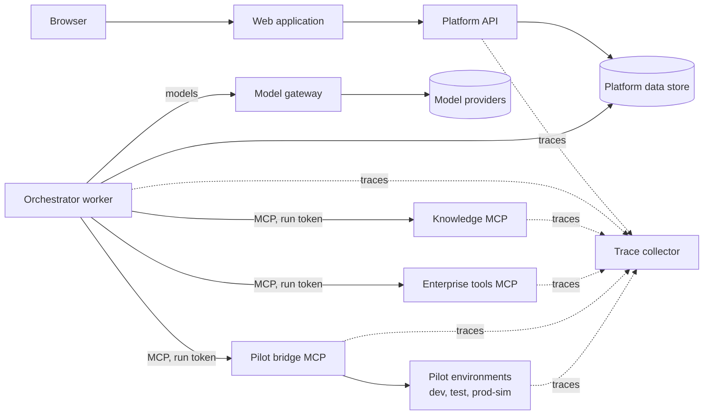
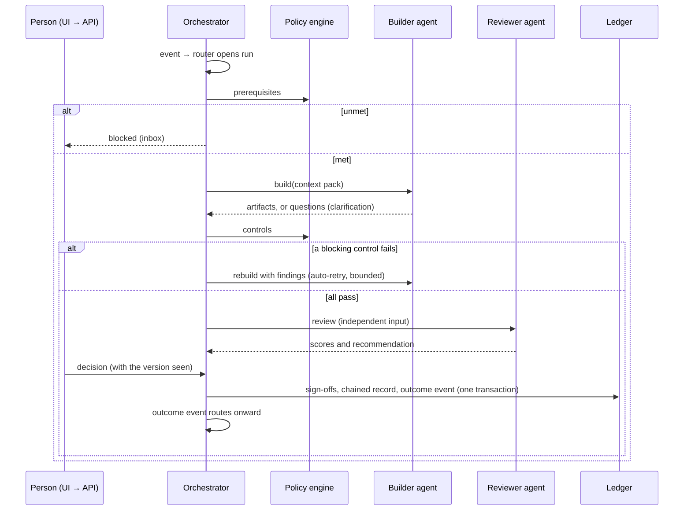

# Agentic ADLC Platform: Technical Design

| | |
| --- | --- |
| **Status** | Draft for development start; to be approved by the architect and the CoE lead |
| **Audience** | Engineers who will build, review, test and operate the platform |
| **Inputs** | [Solution architecture](solution-architecture.md) (SA), [Terminal design spec](terminal-design-spec.md) (TDS), [Build plan](build-plan.md), the constitution (`.specify/memory/constitution.md`) |
| **Outputs** | One Spec Kit feature per build-plan step (`specs/NNN-*/`), each refining the part of this design it delivers |

The SA says what the platform must do and why. This document turns it into a buildable
technical design: the components to develop, their responsibilities and interfaces, the data to
keep, the rules each part must enforce, how it will be tested and deployed, and the decisions and
risks to settle along the way. Details are deliberately left to the feature specs where they
depend on what earlier features learn; those places are marked **To decide in feature NNN**.

---

## Contents

1. [Purpose, scope and goals](#1-purpose-scope-and-goals)
2. [Requirements to design for](#2-requirements-to-design-for)
3. [Design principles](#3-design-principles)
4. [Proposed architecture](#4-proposed-architecture)
5. [Technology choices to confirm](#5-technology-choices-to-confirm)
6. [Repository and project structure](#6-repository-and-project-structure)
7. [Component designs](#7-component-designs)
8. [Data design](#8-data-design)
9. [Interfaces and contracts](#9-interfaces-and-contracts)
10. [Security design](#10-security-design)
11. [Observability design](#11-observability-design)
12. [Pilot use case environment](#12-pilot-use-case-environment)
13. [Deployment and configuration](#13-deployment-and-configuration)
14. [Quality and test strategy](#14-quality-and-test-strategy)
15. [Development approach and plan](#15-development-approach-and-plan)
16. [Phase 2: board as the user interface](#16-phase-2-board-as-the-user-interface)
17. [Risks, assumptions and open decisions](#17-risks-assumptions-and-open-decisions)
18. [Glossary](#18-glossary)

---

## 1. Purpose, scope and goals

### 1.1 What will be built

A platform that runs the **Agentic Development Lifecycle (ADLC)** for AI use cases. A use case
will move through ten **terminals** (lifecycle stages), each defined by a versioned spec:

| Terminal | Stage | Terminal | Stage |
| --- | --- | --- | --- |
| T0 | Intake & Qualification | T5 | Trust, Risk & Assurance |
| T1 | Requirements & Outcome | T6 | Release Readiness |
| T2 | Architecture & Design | T7 | Deployment & Transition |
| T3 | Build & Integration | T8 | Operate & Observe |
| T4 | Evaluation | T9 | Evolve / Retire |

In every terminal run, an **agent will build** the terminal's artifacts, **deterministic
controls** will check them, an **independent reviewer agent** will recommend an outcome, **people
will decide**, and the decision will be **recorded as immutable evidence** and routed as an event
to the next terminal.

### 1.2 MVP scope

- The lifecycle engine, driven only by specs.
- Lifecycle agents for T0–T9 and a common reviewer.
- A policy engine for prerequisites, controls and agent permissions.
- An evidence ledger with tamper detection.
- A web application for intake, the human inbox, decisions and the lifecycle dashboard.
- Tool access for agents through MCP servers, mocked where enterprise systems are not available.
- A pilot use case (an incident triage assistant) that the lifecycle builds, evaluates, deploys
  and operates, in simulated environments.
- One-host deployment, plus a scripted end-to-end demo.

### 1.3 Non-goals for the MVP

- Multi-tenant or multi-host scale, high availability, horizontal scaling.
- Real enterprise integrations (ITSM, CMDB, IAM, GRC): mocks with the real tool shapes instead.
- Single sign-on: local accounts behind an interface that SSO can replace.
- Spec authoring UI: specs are edited as files and reviewed in Git.
- Real production deployment of the pilot: simulated environments only.

### 1.4 Goals and success measures

| Goal | Measure at the end of the MVP |
| --- | --- |
| The lifecycle is defined by specs, not code | Changing a terminal's controls, routes or approvers needs a spec change only; a test proves no terminal value appears in code |
| People decide every outcome | No run closes with an outcome without a human decision (property-tested) |
| Evidence is complete and tamper-evident | Every closed run has a chained ledger record; a verification command detects any change |
| The demo runs end to end | The pilot goes T0 → T9 on one host, including a rework, an exception and an operational event |
| Lifecycle is visible | Journey, activity and the SA §12.3 KPIs are shown from recorded data |

---

## 2. Requirements to design for

### 2.1 Functional

| Area | The design must provide |
| --- | --- |
| Specs | Validation (syntax, schema, single-spec and cross-spec rules, versioning), registration of immutable versions, pinning per use case |
| Orchestration | Opening runs from events, a run state machine, automatic steps, timers and SLAs, rework and reroute, escalation, clarifications, waivers, reliable event delivery |
| Policy | Evaluating prerequisites, controls and conditions; authorising agent and tool actions; resolving parameters within guardrails |
| Agents | Building artifacts from a context pack; an independent review; model access through one gateway; bounded cost and steps |
| Humans | Intake; an inbox per person; decisions, clarification answers, waivers, artifact edits; escalation handling |
| Evidence | Versioned artifacts and attachments; ledger records at close; a versioned use-case profile; verification |
| Tools | Knowledge grounding; enterprise and pilot tools through MCP, scoped per run |
| Visibility | Journey, activity, time split, KPIs, portfolio |

### 2.2 Non-functional

| Quality | Target |
| --- | --- |
| Correctness under concurrency | No two workers process the same event, timer or run step; every state change is atomic |
| Restart safety | Killing any process mid-run loses nothing and duplicates nothing |
| Security | Least privilege for people and agents; secrets from the environment only; fail closed |
| Auditability | Every decision, model call, tool call and policy decision recorded with its inputs |
| Determinism | Computable rules never depend on a model; the same evidence gives the same decision |
| Portability | Runs on one host with or without containers; all hosted infrastructure in Python |
| Maintainability | Typed Python, small modules behind interfaces, one entry point for all checks |
| Demo timing | Lifecycle timers can be compressed so a multi-week flow runs in minutes |

---

## 3. Design principles

The constitution governs every feature. Each article will be backed by a concrete mechanism, so
that it is enforced rather than remembered:

| Article | Rule | Mechanism to build |
| --- | --- | --- |
| I Spec-driven lifecycle | Behaviour comes from specs | A test that scans the code for terminal ids, event names, roles and routes |
| II Superset, not values | Specs declare the superset; values come from catalogues and profiles | Shared catalogues; parameter resolution within guardrails |
| III Agents build, humans decide | Only people close runs with an outcome | Allowed actors per signal in the state machine; property tests |
| IV Separation of duties | Agents act only within granted scopes | Default-deny authorisation before every action; run-scoped tokens |
| V Evidence-first | History is append-only and verifiable | Database guards against update and delete; hash-chained records |
| VI Deterministic before judgement | Rules that can be computed are computed | A policy engine outside the models |
| VII Interfaces at every boundary | Components meet only through declared interfaces | Protocols, APIs, MCP; import-boundary tests |
| VIII Open source, Python first | OSI licences, Python 3.12 | Dependency and licence table in every feature's research |
| IX Test first for the core | Core logic written test first | Gate on tests and coverage in `make check` |
| X Observable by default | Every step leaves a trace | Structured logs, traces, run activity rows |
| XI Secure by default | Fail closed, no secrets in code | Typed settings, secret scanning, redaction |
| XII Simplicity for the MVP | No component without a need | One data store, one host, no broker |
| XIII Naming | SA Annex A | Review checklist; validation rules |

---

## 4. Proposed architecture

### 4.1 Layers

| Layer | Components to build | Responsibility |
| --- | --- | --- |
| Experience | Web application, platform API | Intake, inbox, decisions, dashboards; the only way in for people |
| Orchestration | Event router, run engine, outbox, timers, monitors, worker | Open and drive runs from events; apply routing and timers |
| Agents | Agent runtime, model gateway, reviewer, context builder, tool gate | Produce artifacts and recommendations within limits |
| Policy | Policy engine, predicate catalogue, parameter resolver | Decide every computable rule; authorise agent actions |
| Specs | Spec toolkit, spec registry | Validate, version and serve the lifecycle definition |
| Evidence | Ledger, content store, profile | Immutable evidence and its verification |
| Integration | MCP servers: knowledge, enterprise mocks, pilot bridge | Governed tool access |
| Cross-cutting | Configuration, identity, logging, tracing | Shared foundations |

### 4.2 Processes (target topology)



Design rules for the topology:

- **The API never advances runs**; the orchestrator worker does. The API records people's
  signals; the worker performs automatic steps.
- **The web application never touches the data store**; it calls the API only.
- **Tool servers are separate processes** that import nothing from orchestration, ledger,
  policy, agents or API. The pilot is reachable only through the bridge.
- **One data store** holds specs, runs, evidence and events, so that closing a run, writing its
  ledger record and emitting its event can be one transaction.

### 4.3 A terminal run (target flow)



---

## 5. Technology choices to confirm

Each choice will sit behind an interface so it can change without touching callers. Each will be
recorded as an ADR and confirmed by the CoE.

| Concern | Proposed | Alternatives considered | Rationale | Swap boundary |
| --- | --- | --- | --- | --- |
| Language and tooling | Python 3.12, uv, ruff, mypy strict, pytest | — | Constitution VIII; one language for platform, agents and tools | — |
| Spec format | YAML + JSON Schema + CEL | CUE, Pkl, BPMN | Readable by owners, reviewable in Git, validatable | The registry stores parsed JSON |
| Workflow (ADR-01) | Own state machine in the data store, one transaction per signal | LangGraph checkpointer, Temporal, Camunda | One copy of run state; atomic close; restart safety from the store | `TerminalRun` interface |
| Data store (ADR-04) | One SQLite file (WAL), SQLAlchemy Core, Alembic | PostgreSQL; separate stores per concern | One host, no server to run, transactional; all-Python hosting | Engine factory; table prefixes per area |
| Events | Transactional outbox, polled | Kafka, LISTEN/NOTIFY, cloud bus | No broker for the MVP; atomic with state changes | Router interface |
| Models (ADR-02) | One gateway on LiteLLM; tiers mapped to models per profile; Anthropic primary, then OpenAI, then Gemini | Direct provider SDKs | Central model swap, fallback, cost tracking | Tier names |
| Agent framework (ADR-02) | Own bounded loop | Agent SDKs, LangGraph | Few needs; full control of limits and records | `AgentRunner`, `Reviewer` |
| Policy (ADR-03) | CEL plus a catalogue of predicates | OPA/Rego, Cedar | Simple to embed; expressive enough; explainable failures | `evaluate`, `authorize` |
| Tools | MCP servers (streamable HTTP) | Direct API clients | One protocol for every tool; real servers can replace mocks | MCP registry |
| API | FastAPI, pydantic | Flask, Django | Typed, fast to build, OpenAPI | HTTP contract |
| Web application (ADR-05) | Streamlit | React | Speed of delivery for an MVP | API only |
| Files | Content-addressed store on disk | S3 / MinIO | One host, no extra service | Storage adapter |
| Tracing (ADR-06) | OpenTelemetry to Arize Phoenix | Jaeger, Langfuse, LangSmith | Python-native, OTLP, agent-aware views | OTLP export |
| Hosting (ADR-07) | Docker Compose on one host; a process runner without Docker | Kubernetes | Fast to stand up; same processes either way | Container images |
| CI | GitHub Actions calling `make check` | GitLab CI, Jenkins | No check lives only in CI | Make targets |

**Known consequence of SQLite** (to accept in ADR-04): there are no database identities, so the
data store cannot stop a process with file access from removing a guard. The design compensates
with guards for every connection and a hash chain that detects any change (section 8.4).

---

## 6. Repository and project structure

| Path | Will contain |
| --- | --- |
| `src/adlc/<package>/` | The platform, one package per component (section 7), each with a README |
| `adlc-specs/` | Runtime specs: terminals, checklists, playbooks, prompts, shared catalogues, JSON Schemas. Never under `specs/` |
| `db/migrations/` | Alembic environment and revisions |
| `tests/` | `unit/`, `integration/`, `scenario/`, `fixtures/`, `support/` |
| `pilot/` | The pilot use case as its own project (no platform imports) |
| `deploy/` | Compose file, Dockerfiles, process file for running without Docker, helper scripts |
| `scripts/` | Demo driver, resilience drill, synthetic data, migration check |
| `data/` | Synthetic evidence, knowledge documents; a git-ignored local data folder |
| `docs/` | SA, TDS, build plan, this design, operating guides, diagrams |
| `specs/NNN-*/` | Spec Kit feature folders |
| `Makefile` | The single entry point for developers and CI |

Separate projects (own `pyproject.toml` and lock file) will be used wherever a component must
share nothing with the platform: the pilot, and later the board simulator (section 16).

---

## 7. Component designs

Each component below lists its responsibility, what it will expose, the rules it must enforce,
and what is left to its feature.

### 7.1 Foundations (feature 001)

**Configuration (`config`).**
- Typed settings read **only from the environment**. No configuration files, no defaults for
  secrets.
- A missing or invalid setting stops start-up with one line per setting: its name, missing or
  invalid, and the expected form. The value is never printed.
- Secrets will be typed as secret values, and `.env.example` will be kept in step with the
  settings model by a test.
- Durations will use `<int><unit>`. Avoid `m`, which the TDS uses for months.

**Data store (`db`).**
- One engine factory used by every process.
- Write transactions take the write lock at their start, so two workers can never claim the same
  work. Reads never wait for writers.
- Times stored in UTC with microseconds.
- Services never create the store; only migrations do.
- **To decide in 001:** value adapters for JSON, UUID and timestamps; the guard mechanism for
  append-only tables.

**Identity (`identity`).**
- An `IdentityProvider` protocol (sign in, current person, roles, sign out), so SSO can replace
  local accounts later.
- **Local accounts** live in a file outside the repository, with password hashes only.
- **Roles** must exist in the role catalogue (`adlc-specs/shared/roles.yaml`). No role names in
  code.
- **Sessions** are signed tokens with an expiry.

**Observability (`observability`).**
- Logging with redaction of credential-like fields.
- OpenTelemetry tracing per process. Exporter failures must never affect requests.

**Migrations.**
- Numbered, repeatable and reversible.
- A check that upgrades, downgrades and upgrades again on a scratch store.

### 7.2 Spec toolkit and registry (feature 002)

**Validation levels:**

| Level | Checks |
| --- | --- |
| L1 | Parse and layout |
| L2 | JSON Schema |
| L3 | Rules within one spec |
| L4 | Rules across specs and catalogues, including the event and route graph (no unreachable terminals, no dangling routes) |
| L5 | Version bumps against `main` and against the registry |

**Rules:**
- Every finding names the file, line and rule id.
- Rule ids are documented in a contract table, and a test keeps the table and the code equal.

**Registration:**
- Writes new versions in one transaction. Registered versions are never changed.
- Playbooks and prompts are hashed, so the runtime can prove it uses the registered text.

**Run-time reads:**
- Through a `SpecRegistry` interface with two implementations, SQL and in-memory, sharing one
  set of projection functions.
- No code reads YAML at run time.
- A use case **pins** spec versions at submission and keeps them for its whole life.

**To decide in 002:** the full rule list; how validation finds the baseline in CI.

### 7.3 Lifecycle orchestration (feature 003)

**State machine.** A pure transition table holds the states, the signals, who may send each
signal, and the effects:

```text
opened ─► building ─► checking ─► reviewing ─► awaiting_sign_off ─► closed
  │           │  ▲         │                         │  ▲
  ▼           ▼  └─retry───┘                         │  └─ waiver rejected
blocked   awaiting_clarification                      ▼
                                        escalated ─► awaiting_sign_off
```

Property tests will prove two things: only human decisions close a run with an outcome, and
only the orchestrator's rules escalate.

**Engine.** It will apply **one signal per transaction**:
1. lock the run;
2. compute the transition;
3. execute the effects;
4. append the transition and the activity.

Closing a run will write the sign-offs, the chained ledger record and the outcome event in the
same transaction.

**Automatic steps** (prerequisites, build, controls, review):
- The worker leases the run.
- It calls the policy engine, agent or reviewer **outside** any transaction, because these calls
  may take minutes.
- It applies the result with a version check. A result for a run that has moved on is recorded
  as stale, and an expired lease counts as a retry.

**Versions.** Every run has a version. Human operations must send the version they saw, and a
mismatch is refused as stale.

**Events and routing:**
- Event names follow SA Annex A: `<terminal>.<outcome>[.<root cause>]`.
- The router opens runs where a pinned spec's trigger matches, and signals waiting runs.
- Outcome routes and event routes come only from specs.

**Outbox:**
- Delivery is ordered per use case and idempotent (processed events are recorded).
- Retries use increasing delays, then a **dead letter** that the CoE role can inspect and
  re-queue.

**Timers:**
- Escalation after a deadline, clarification SLA, and periodic review for continuous terminals.
- All delays are multiplied by a time scale, for demos.

**Monitors** (for continuous terminals):
- Thresholds declared in specs are evaluated periodically by the policy engine.
- A breach raises an operational event once per episode.

**Worker.** A polling loop that leases work and writes a heartbeat.

**Interfaces it depends on:** `PolicyEngine`, `AgentRunner`, `Reviewer`, `Clock`, with
scriptable stubs, so 003 can be built and tested before 004 and 006 exist.

**To decide in 003:**
- retry delays and the dead-letter threshold;
- lease length;
- the escalation rules (rework limit, SLA breach, clarification limits, budget).

### 7.4 Policy engine (feature 004)

| Operation | Used for |
| --- | --- |
| `evaluate(expression, context)` | Prerequisites, controls, approver and follow-on conditions, monitor thresholds |
| `authorize(actor, action, resource, context)` | Agent and tool actions: run scope, then deny, then allow, then **default deny** |

**Evaluation:**
- CEL expressions are compiled once.
- Paths are resolved against **evidence**: earlier terminals' closed runs, the run, intake,
  timeline, tier, waivers, parameters and the directory.
- Catalogued predicates explain each failure: the table, row and column, or the missing path.

**Fail closed.** Anything but `true` is *not passed*, with a reason. Errors, missing evidence,
wrong result types and resource limits (time, rows, characters) all fail closed.

**Evidence providers:**
- One interface per source.
- A **synthetic** provider supplies sources not yet integrated, and every decision that reads it
  is labelled synthetic.

**Parameters.** Values left open by specs are resolved within guardrails when a run opens, then
frozen.

**Audit.** Every call appends one decision record with its inputs and reason.

**To decide in 004:** the predicate catalogue; resource limits; how real providers replace
synthetic ones.

### 7.5 Evidence ledger (feature 005)

- **Content store.**
  - Structured content is addressed by the hash of its normalised JSON.
  - Files go to a content-addressed store, written atomically.
  - Uploads are checked for size, type and content. Office files with macros are refused.
- **Artifact versions.** A new version is written only when content changes. It names its
  producer: an agent attempt or a person.
- **Person edits:**
  - An edit creates a version.
  - It voids earlier pass approvals and withdraws a pending waiver.
  - It bumps the run version.
- **Ledger record at close.** It holds:
  - each artifact's id, version, content hash, producer and attachments;
  - emitted values;
  - the profile version;
  - the package the evidence is bound to;
  - the hash of the previous record of the use case (the chain).
- **Use-case profile.** Versioned values that later terminals read. A passing close that emits
  values writes the next version.
- **Verification.** A command will recompute the chain and the content hashes for one use case
  or for all, and record each verification.

**To decide in 005:** the record content format and its version; the binding rule; the file type
allow-list.

### 7.6 Agent runtime (feature 006)

- **Model gateway:**
  - An agent asks for a **tier** (`reasoning`, `coding`, `standard`), never a model.
  - A model catalogue maps each tier to an ordered list of models per **profile** (for example
    `default`, `dev`).
  - The gateway will skip models without a key, models not approved for the run's data class
    (an unknown class fails closed), and models whose context is too small.
  - It falls back to the next model **only on outages**, not on bad answers.
  - Only one transport module will call providers. Keys are passed per call and never logged.
- **Builder loop:**
  - Bounded steps, tokens and time per tier, with per-terminal overrides.
  - Output validated against each artifact's schema, with a limited number of correction rounds.
- **Context pack:**
  - Intake, prerequisite evidence, earlier artifacts, playbooks and prompts (hash-checked against
    the registry), and grounding.
  - Untrusted text is fenced as data.
  - The pack is hashed for the record.
- **Reviewer.** It gets the artifacts and the checklist but **never the builder's reasoning**.
  It returns scores, findings and a recommendation.
- **Tool gate.** Every tool call is authorised by the policy engine first.
- **Records:** model calls (tokens, cost, outcome), attempts, retrievals, citations, cost alerts.
- **Start-up check.** Refuse to start when a needed tier has no usable model.

**To decide in 006:** limits per tier; the cost alert levels; the reviewer's output schema; the
replay and quality report for regression testing of agents.

### 7.7 Human inbox and web application (feature 007)

**API rules:**
- **Who acts is always the signed-in person.** A request naming an actor or role is refused.
- **Role rules are shared:** the inbox and the operations use the same functions, so the inbox
  never offers an action the operation would refuse.
- **One error format:** not signed in, not allowed, not found, stale, wrong state, invalid.

**Inbox.** Derived, never stored. It will show:
- sign-offs still needed from the person's roles;
- clarifications addressed to them;
- escalations;
- waivers to approve;
- blocked runs;
- dead letters (CoE only).

The list is ordered soonest due first.

**Decision form.** Built from the pinned spec:
- the allowed outcomes and the fields each one requires;
- root causes for rework;
- the reviewer's recommendation (deciding differently needs a reason).

**Web application:**
- Calls only the API. The session token stays on the server.
- Text written by people or agents is shown only as plain text, never as Markdown or HTML.
- Attachments are offered for download only, with safe headers.

**To decide in 007:** the page list and navigation; refresh behaviour; the spreadsheet import for
table artifacts.

### 7.8 Knowledge and tools (features 008 and 010)

**Knowledge server:**
- Read-only MCP servers, one per source folder, with `search` and `read`.
- Scope (from the pinned spec) and the data-class limit are enforced by the server as well as by
  the platform.
- A bearer token is required, and host headers are checked.

**Enterprise mocks:**
- ITSM, CMDB, IAM, GRC, eval store, agent registry, control library.
- They have the tool names and shapes a real server would have, so a real system can be swapped
  in by configuration.

**Pilot bridge:**
- The only component on both networks.
- Its tools act on the pilot: environments, git, CI, artifact and prompt stores, datasets,
  evaluation harness, red team, personal-data scan, deploy, traffic, kill switch, monitoring,
  feedback.

**Run tokens:**
- Short-lived, signed, carrying the run's tool scopes and **bound values**: branch, environment,
  candidate and authorised package.
- Bound values are fixed by the platform from evidence, never by the model.
- Synthetic or ambiguous evidence binds nothing, and the call is refused.

**Checked twice:** the tool gate authorises the call, then the server verifies the token.

**Records:** every call, including refusals, and every evidence result.

**To decide in 010:** the tool catalogue and its contract; time limits; the registry format
(which process serves which server).

### 7.9 Terminal agents (features 008, 011, 012)

- Each terminal's builder will be configured by its spec, playbooks and prompts. There is no
  terminal-specific code.
- Delivery order: T0–T2 (grounded in knowledge), then T3–T5 (build, evaluate, assure the pilot),
  then T6–T9 (release, deploy, operate, evolve).
- Continuous terminals (T8) add monitors, change requests and proposed operational events.

### 7.10 Lifecycle dashboard (feature 013)

Read-only views over recorded data. No new instrumentation.

| View | Shows |
| --- | --- |
| Journey | A lane per terminal, a bar per run, and arrows for rework, reroute, exception, events and re-entry |
| Activity | The activity feed with filters |
| Time split | Time per state: agent, reviewer, clarification, people, blocked |
| KPIs (SA §12.3) | Elapsed time, reworks, first-pass yield, reviewer–human agreement, edit rate, control pass rate, SLA adherence |
| Portfolio | The KPIs across use cases |

A KPI with no data shows "no data", never zero.

### 7.11 End-to-end demo (feature 014)

- A scripted driver that acts as the people, can resume from a step, and can run with simulated
  or live models.
- A resilience drill covering three cases:
  1. kill the worker mid-run: the run continues once;
  2. duplicate event delivery: the run opens once;
  3. a faulted event: it is dead-lettered, re-queued and delivered.

---

## 8. Data design

### 8.1 Areas

One data store, divided into four owned areas (SA §10):

| Area | Will hold | Owner |
| --- | --- | --- |
| `spec` | Registered specs, catalogues, routes, triggers, timelines, playbooks, prompts | 002 |
| `run` | Use cases, pins, runs, transitions, activity, sign-offs, clarifications, waivers, timers, parameters, policy decisions, agent attempts, model calls, retrievals, citations | 003, 004, 006, 008 |
| `ledger` | Ledger records, content, files, artifact versions, attachments, checklist results, profiles, verifications | 005 |
| `events` | Outbox, processed events, dead-letter actions | 003 |
| `tools` | Tool calls, results, mock records | 010 |

With SQLite, areas will be table-name prefixes. Each feature's data model will define its tables.

### 8.2 Rules for all data

- **Append-only history.** Transitions, activity, sign-offs, decisions, model and tool calls,
  content, artifact versions and ledger records will never be updated or deleted. Database
  guards will refuse it for every connection.
- **Mutable state is minimal:** current run state and version, leases, timers, outbox status.
- **Identifiers:**
  - use cases `UC-nnnn`, waivers `WVR-nnnn`;
  - runs and events time-ordered UUIDs (v7);
  - content by sha256.
- **Times:** UTC with microseconds, stored so that text order is time order.
- **JSON:** stored as text, normalised before hashing.

### 8.3 Migrations

- One baseline revision per release before the first deployment; incremental revisions after.
- Every revision reversible, checked in CI by upgrade, downgrade and upgrade again.

### 8.4 Integrity

- Ledger records will form a **hash chain** per use case. Each record holds the hash of the
  previous one, and the hashes of its content.
- Verification will detect any changed, removed or reordered record, including changes made by
  bypassing the database guards.

### 8.5 Retention

All MVP data is kept. **To decide:** retention and archiving after the MVP.

---

## 9. Interfaces and contracts

Each will be written as a contract in its feature's `contracts/` folder before it is built.

| Interface | Between | Form |
| --- | --- | --- |
| `TerminalRun` | API and worker → engine | Python protocol |
| `PolicyEngine` (`evaluate`, `authorize`) | Engine, agents, tools → policy | Python protocol |
| `AgentRunner`, `Reviewer` | Engine → agents | Python protocols |
| `SpecRegistry` | Everything → specs | Python protocol |
| `IdentityProvider` | API → identity | Python protocol |
| `EvidenceProvider`, `ProfileSource` | Policy → evidence sources | Python protocols |
| Platform API | Web application, demo driver → platform | HTTP/JSON, sessions, versioned operations |
| Knowledge MCP | Agents → knowledge | MCP tools `search`, `read` |
| Tools MCP, pilot bridge MCP | Agents → tools | MCP tools with run tokens |
| Pilot HTTP API | Bridge → pilot | HTTP/JSON |
| Spec files | Spec owners → platform | YAML + JSON Schema + CEL; validation rules table |
| Settings | Operators → every process | Environment variables, documented in `.env.example` |
| Make targets | Developers and CI → repository | `make check`, `make up`, `make local`, `make demo`, ... |

### 9.1 Planned API surface (refined in 007 and 013)

| Area | Operations |
| --- | --- |
| Auth | sign in, sign out, who am I |
| Use cases | submit, list, detail, journey, verify evidence |
| Inbox | items for the signed-in person |
| Runs | detail, decide, complete an escalation, edit artifacts, upload, attachment history and download |
| Requests | answer clarifications, decide waivers, dead letters (list, detail, re-queue) |
| Operations | change requests, proposed events |
| Dashboard | journey, KPIs, activity, portfolio, run timeline |

Every operation that changes a run will carry the expected version.

---

## 10. Security design

| Threat or need | Design |
| --- | --- |
| Impersonation | Signed, expiring sessions; password hashes only; the acting person always comes from the session |
| Privilege misuse by people | Roles from the catalogue; who may act is computed from the pinned spec and enforced by the API |
| Agents exceeding their remit | Default-deny authorisation of every action; run tokens with scopes and bound values; checked again by every tool server |
| Prompt injection | Untrusted text fenced as data; tools take bound values from evidence, not from the model; the reviewer is independent of the builder |
| Data leakage to models | Models approved per data class; unknown class fails closed; knowledge filtered by data class |
| Secret exposure | Environment only; never logged, traced or stored; secret scanning in `make check`; `.env` git-ignored |
| Unsafe content in the UI | Plain-text rendering of user and agent text; download-only attachments with sandboxing headers; upload checks |
| Evidence tampering | Append-only guards; hash chain; verification command |
| Lateral movement | The pilot on its own network, reached only through the bridge; host-header checks on MCP servers |

**Accepted for the MVP** (to record):
- no single sign-on and no lockout;
- session revocations may not survive restarts;
- the data store cannot prevent a process with file access from tampering, but verification
  detects it.

---

## 11. Observability design

- **Logs:**
  - Structured, to standard error, with the level set by the environment.
  - Credential-like fields are redacted.
  - Request bodies are never logged.
- **Traces:**
  - OpenTelemetry in every process, exported over OTLP to the trace collector.
  - Platform and pilot traces go to separate projects.
  - Span attributes come from an allow list; headers are never captured.
- **Run activity.** Every step writes an activity row: who, what step, and the outcome. The
  dashboard is built only from these rows and the run history.
- **Health:**
  - Every service has a health endpoint.
  - The worker writes heartbeats, and a stale heartbeat means the worker is down.
- **Pilot telemetry.** The bridge reads the pilot's spans from the trace collector for the
  monitoring tools that T8 uses.

---

## 12. Pilot use case environment

- **Use case.** An **incident triage assistant**: for an incident it returns a category, a
  priority, a resolver team and a reason, using two mocked tools (a service catalogue and a team
  directory).
- **Its own project.** It shares no code with the platform.
- **Golden template:**
  - Fixed agent code, reference data and environment definitions.
  - T3 writes only the **fill**: instructions, routing rules, tool bindings, thresholds and
    settings.
- **Packages:**
  - A build validates the fill and writes a deterministic archive.
  - Its hash identifies what gets evaluated, assured and deployed, and evidence is bound to it.
- **Environments.** `dev`, `test` and `prod-sim`, as local processes.
  - prod-sim supports stable and candidate deployments, traffic splits (shadow, canary, full) and
    fault injection (model swap, personal-data leak).
  - Every operation is appended to records.
- **Traffic and data.**
  - Reproducible synthetic incidents, optionally with planted personal data.
  - A steady traffic generator that reports accuracy and leak rate.
- **Models.** A deterministic simulated model by default; a real model can be switched on in dev
  and test.

**To decide in 009:** the fill schema; the environment API; the fault behaviours; the record
format.

---

## 13. Deployment and configuration

### 13.1 With containers

One compose file with:
- **set-up jobs:** migrate, and register specs;
- **platform services:** API, web application, worker, knowledge, tools, trace collector;
- **the pilot bridge**, on both networks;
- **pilot services:** three environments, traffic and lab.

Networks: `platform` and `pilot`. Named volumes hold the data store, files, traces and pilot data.

### 13.2 Without containers

The same processes, run by a Python process runner from a process file. Settings are layered:
`.env`, then a local overlay with localhost addresses. Data goes in a git-ignored local folder.
A set-up step will migrate the store and register the specs.

### 13.3 Configuration

- **Source:** environment variables only; `.env` for local use.
- **Environment:** `ADLC_ENV` is `dev` or `demo`. `demo` refuses placeholder credentials and
  requires confirmation before destructive targets.
- **Time scale:** compresses lifecycle timers for demos.
- **Secrets:**

  | Group | Secrets |
  | --- | --- |
  | Sessions | session secret |
  | Models | provider keys |
  | Tools | knowledge token, tool token key |
  | Pilot | pilot model key |

### 13.4 Ports (proposed)

| Port | Process | Port | Process |
| --- | --- | --- | --- |
| 8000 | Platform API | 8101–8103 | Pilot dev, test, prod-sim |
| 8501 | Web application | 8200 | Pilot traffic |
| 8020 | Knowledge MCP | 8300 | Pilot lab |
| 8030 | Tools MCP | 6006 | Trace collector |
| 8040 | Pilot bridge MCP | | |

---

## 14. Quality and test strategy

### 14.1 Test levels

| Level | Scope | Examples |
| --- | --- | --- |
| Unit | Pure logic | Transition table, CEL evaluation, validation rules, gateway rules, token signing, settings |
| Property | Invariants | Only humans close with an outcome; only rules escalate; idempotent delivery |
| Integration | Against a real data store and real processes in-process | Engine, outbox, ledger, API routes, MCP servers, UI rendering |
| Scenario | Multi-terminal flows | Rework, reroute, exception, escalation, re-entry |
| Contract | Interfaces | Tool catalogue equals its contract; validation rule table equals the code |
| Boundary | Architecture rules | Import boundaries; no terminal values in code; `.env.example` equals the settings model |
| Resilience | Restart and failure | Worker killed mid-run; duplicate delivery; dead letter |
| Agent quality | Model behaviour | Replay of reference use cases with a quality report |

### 14.2 Gates

`make check` will run, in order:
1. lint and format check;
2. strict type check;
3. spec validation;
4. tests with coverage;
5. the pilot's checks;
6. the migration check;
7. secret scanning.

CI will run exactly `make check` on every pull request and every push to `main`. Core modules
will be written test first (constitution IX), with a coverage gate.

### 14.3 Test data

- Synthetic evidence for sources not yet integrated, always labelled.
- Fixture spec bundles: one valid bundle, plus one patch per validation rule.
- Fake model transports with scripted replies, so tests never call a provider.

---

## 15. Development approach and plan

### 15.1 Workflow

Spec Kit, one feature at a time, with three review gates:

```text
specify → clarify → Gate 1 (spec) → plan → checklist → Gate 2 (plan)
        → tasks → analyze → Gate 3 (tasks) → implement → converge → pull request
```

Each feature will produce its spec, research (decisions and licences), data model, contracts,
quickstart and tasks. Each feature will be merged before the next starts.

### 15.2 Feature order (MVP)

| # | Feature | Delivers | Depends on |
| --- | --- | --- | --- |
| 001 | Platform foundation | Settings, data store, migrations, identity, sessions, logging, tracing, compose skeleton, `make check` | — |
| 002 | Terminal spec toolkit | Validation L1–L5, registration, registry | 001 |
| 003 | Lifecycle orchestration | State machine, engine, router, outbox, timers, worker (with stubs) | 001, 002 |
| 004 | Policy engine | `evaluate`, `authorize`, predicates, evidence, parameters | 003 |
| 005 | Evidence ledger | Content store, artifact versions, chained records, profile, verification | 003, 004 |
| 006 | Agent runtime | Gateway, builder and reviewer loops, context, limits, cost | 003, 004 |
| 007 | Human inbox | API operations, inbox, forms, web application | 003–006 |
| 008 | Terminal agents T0–T2 | Knowledge server, grounded agents | 006, 007 |
| 009 | Pilot environments | Pilot project, template, packages, environments, traffic | — |
| 010 | MCP servers | Tool servers, run tokens, pilot bridge | 004, 006, 009 |
| 011 | Terminal agents T3–T5 | Build, evaluate, assure the pilot | 008–010 |
| 012 | Terminal agents T6–T9 | Release, deploy, operate, evolve; monitors; change requests | 011 |
| 013 | Lifecycle dashboard | Journey, activity, KPIs, portfolio | 007 |
| 014 | End-to-end demo | Demo driver, resilience drill, demo reset | All |

### 15.3 Definition of done (every feature)

- All of the following pass `make check`: tests written first for core logic, lint, types,
  coverage gate.
- Contracts written and covered by tests.
- No terminal-specific or use-case-specific values in code.
- Every new step leaves run activity and traces.
- Every new dependency recorded with its licence.
- A README in every new package; operating documentation updated.
- The feature's quickstart walked through and its outcome recorded.

---

## 16. Phase 2: board as the user interface

After the MVP, people will work from an **Azure DevOps-style board** instead of the web
application (SA §22, Option A first: the board as the interface, the backend unchanged).

| # | Feature | Delivers |
| --- | --- | --- |
| 015 | Board simulator API | A separate project serving an ADO REST 7.1 subset: work items with JSON Patch and revision checks, history, a WIQL subset, links, comments, process and identities, tokens; a published contract with fixtures |
| 016 | Engagement layer | The platform's adapter: outbound updates, inbound sync from revisions, mapping board changes to signals, refusing changes without decision rights |
| 017 | Board view | The simulator's board: an Epic per use case, columns per terminal |
| 018 | Backlog and form | Work item form for decisions, clarifications and comments |
| 019 | Operations console | Reconciliation and operator commands |
| 020 | End-to-end demo on the board | The MVP demo driven from the board |

Design rules for Phase 2:
- **The simulator is a separate project.** It shares no code with the platform; the published
  contract is the only interface.
- **The board is a view, not an authority.** The platform keeps the decision rights and the
  evidence. A board change by someone without the right will be reverted, with a comment
  explaining why.
- **Sync reads revisions, not only the current state,** so no intermediate change is missed. It
  excludes the platform's own service account.

Option B (work plans, dispatch, increments; features 021–024) will follow if approved.

---

## 17. Risks, assumptions and open decisions

### 17.1 Risks

| Risk | Impact | Mitigation |
| --- | --- | --- |
| Spec complexity outgrows validation | Wrong routing found late | L4 graph checks; scenario tests per route |
| Model behaviour varies | Flaky builds, cost overruns | Bounded loops, schema validation, deterministic controls, replay reports, cost alerts |
| SQLite write contention | Slow steps under load | One writer by design; model and tool calls outside transactions; short transactions |
| Synthetic evidence hides integration gaps | Demo passes, reality fails | Every synthetic decision labelled; real providers replace synthetic sources one by one |
| Prompt injection through artifacts or documents | Agents misuse tools | Fencing, default-deny authorisation, bound values, independent reviewer |
| Board fidelity | The adapter breaks on real ADO | Contract from the published reference; a recorded list of differences to confirm before connecting a real tracker |
| Scope creep | MVP late | Constitution XII; non-goals in section 1.3; gate reviews |

### 17.2 Assumptions

- One host is enough for the MVP demo and pilot.
- Model providers' APIs and the model catalogue are available, with keys provided by the
  environment.
- Enterprise systems can be represented by mocks with the real tool shapes.
- Spec owners maintain the terminal specs in Git.

### 17.3 Open decisions

| Decision | Owner | When |
| --- | --- | --- |
| ADR-01 to ADR-07 (section 5) | Architect, CoE | Before or during the feature that needs each |
| Model catalogue entries and data-class approvals | CoE | 006 |
| Escalation limits, retry delays, SLAs | Process owners | 003 |
| Predicate catalogue | Policy owners | 004 |
| File types allowed for upload | Security | 005 |
| Retention and archiving | Data owner | After the MVP |
| SSO provider | Security | After the MVP |
| Phase 2 option and ADR-08 to ADR-11 | Architect, CoE | Before 015 |

---

## 18. Glossary

| Term | Meaning |
| --- | --- |
| Terminal | One lifecycle stage (T0–T9), defined by a terminal spec |
| Run | One pass of a use case through a terminal, with a state and a version |
| Signal | An input to the run state machine (agent result, decision, timer, event) |
| Outcome | The human decision that closes a run: pass, rework, exception, escalate, terminate, ... |
| Pin | The spec versions a use case uses for its whole life |
| Prerequisite | A condition that must hold before a run builds |
| Control | A deterministic check on a run's artifacts |
| Waiver | An approved exception to a failed control, with an expiry |
| Context pack | The hashed inputs given to an agent |
| Tier | A model class (`reasoning`, `coding`, `standard`) mapped to models by the catalogue |
| Run token | A short-lived signed token that scopes an agent's tool calls |
| Bound value | A tool argument fixed by the platform from evidence, never by the model |
| Ledger record | The hash-chained record written when a run closes |
| Package | A built version of the pilot, identified by its hash |
| Fill | The parts of the pilot's template that T3 writes |
| Synthetic evidence | Stand-in evidence for a source not yet integrated, always labelled |
| Outbox | The table from which events are delivered reliably after a transaction commits |
